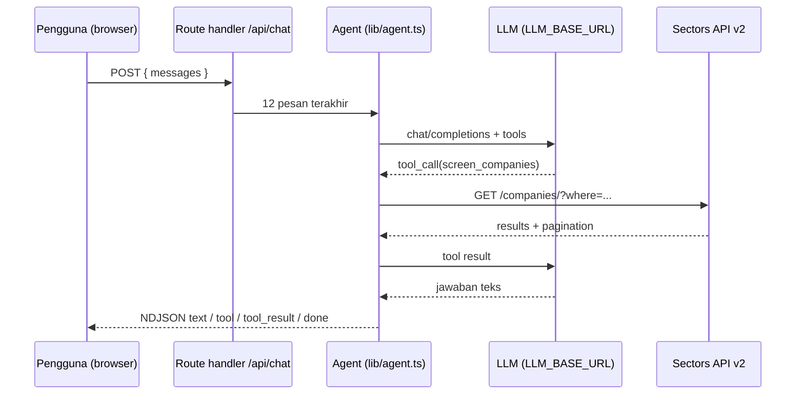

# Cara kerja

Fhin VEST menjalankan **satu loop tool-calling terbuka**: model memilih tool, kode mengeksekusinya,
hasilnya dikembalikan ke model. Tidak ada jawaban yang ditulis tanpa data.

## Loop agent

1. Pengguna mengirim pertanyaan.
2. Agent (OpenAI-compatible, `stream: true`, `temperature: 0`) memutuskan: butuh data apa?
3. Model memanggil satu atau lebih tool. Servernya yang mengeksekusi, bukan model.
4. Hasil tool (JSON) dikembalikan ke model.
5. Diulang maksimal **4 putaran**, lalu model menulis jawaban akhir.

Setiap langkah dikirim ke browser sebagai event NDJSON: `text`, `tool`, `tool_result`, `done`, `error`.

## Empat tool

| Tool | Endpoint Sectors | Kapan dipakai |
| --- | --- | --- |
| `screen_companies` | `/companies/` | Cari/urutkan emiten dengan kondisi (utamakan `where`) |
| `get_company_report` | `/company/report/{symbol}/` | Detail satu simbol; minta section yang perlu saja |
| `get_top_movers` | `/companies/top-changes/` | Gainer/loser per periode |
| `get_quarterly_financials` | `/financials/quarterly/{symbol}/` | Tren kuartal satu simbol |

## Batas yang disengaja pada loop

* **`id` tool_call yang hilang.** Sebagian router menghilangkan `id` saat streaming. Kalau kosong, kode
  membuat id sendiri dan memakai nilai yang sama di assistant message dan tool reply.
* **Hasil tool panjang.** Di atas 60.000 karakter, hasil diganti objek
  `{ truncated: true, note, preview }`. Tidak pernah dipotong dengan `.slice()` karena itu merusak JSON.
* **Biaya.** Setiap panggilan dihitung kreditnya (lihat tabel di [pendahuluan](README.md)); ledger dikirim
  di event `done`.
